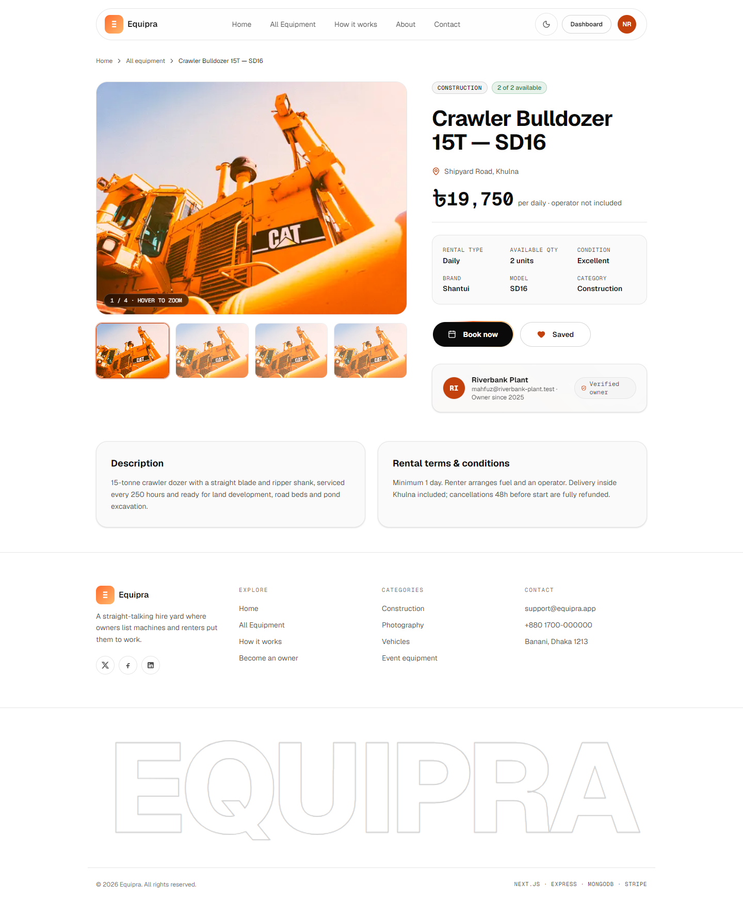
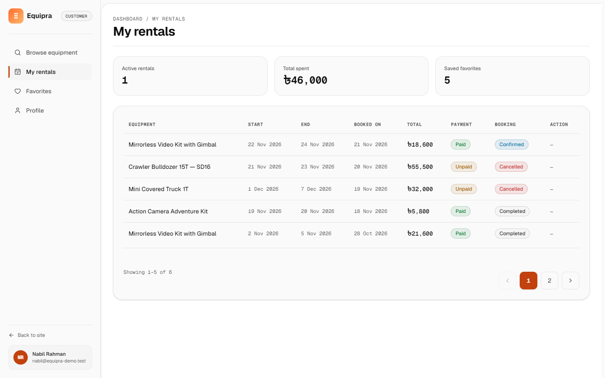
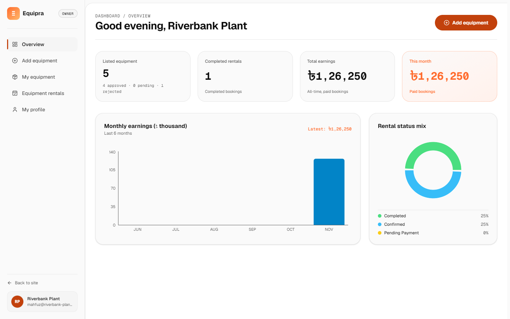
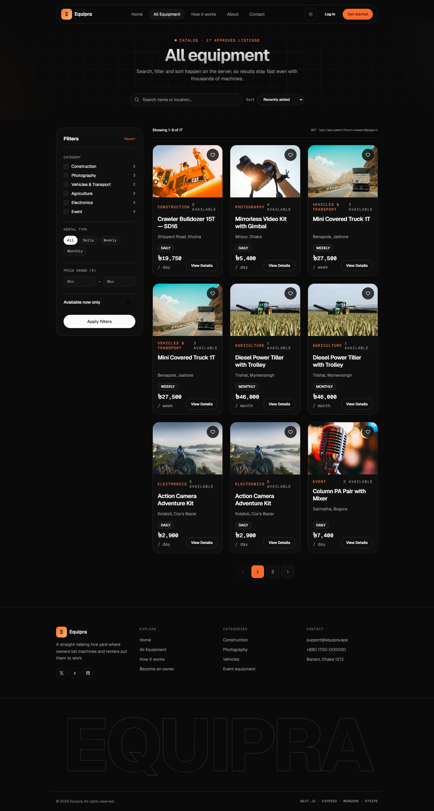
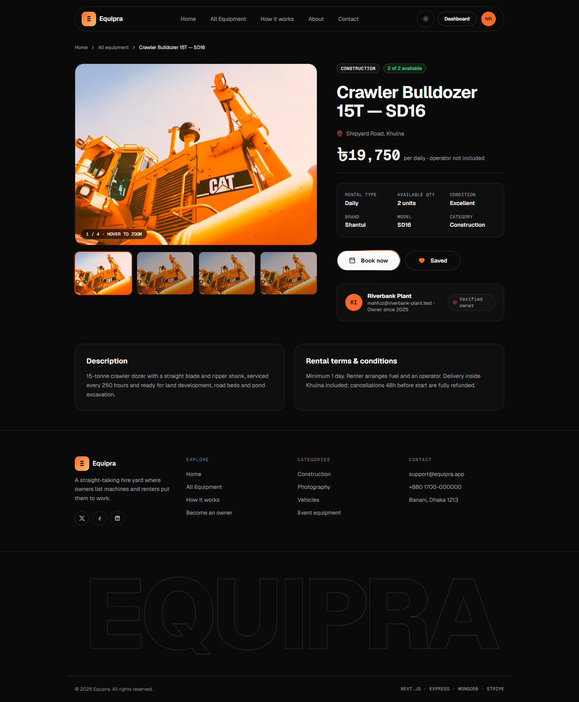
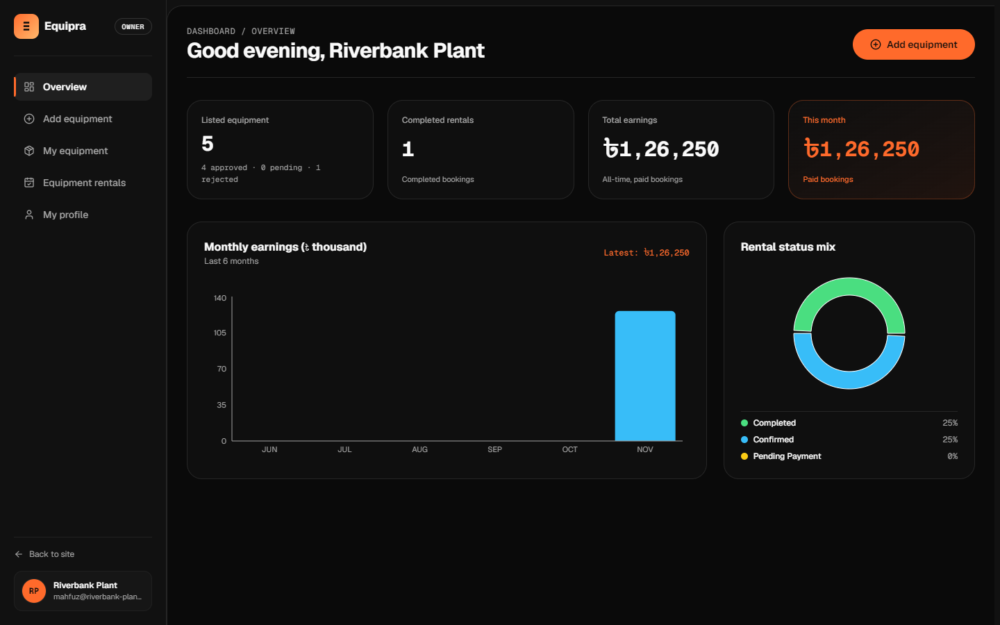

# Equipra

Equipra is a hire yard for heavy gear and event kit. Owners put up machines, an admin clears each listing, and customers find it, hold dates, and check out with Stripe. Nothing is confirmed until the money lands.

- Live site: `https://equipra-client.vercel.app`
- API: `https://equipra-server.vercel.app` ([PHA-9-Equipra-server repo](https://github.com/ariandesu/PHA-9-Equipra-server)) · [PHA-9-Equipra-client repo](https://github.com/ariandesu/PHA-9-Equipra-client)

## Try it

| Role | Email | Password |
| --- | --- | --- |
| Admin | `admin@equipra.app` | `Admin@123456` |
| Owner | `mahfuz@riverbank-plant.test` | `Rent@123456` |
| Owner | `tanisha@framecraft-studio.test` | `Rent@123456` |
| Customer | `nabil@equipra-demo.test` | `Rent@123456` |
| Customer | `siam@equipra-demo.test` | `Rent@123456` |

Made by `npm run seed` (passwords come from `SEED_ADMIN_PASSWORD` / `SEED_USER_PASSWORD`). These are **demo test credentials**, not real secrets.

- Stripe test card: 4242 4242 4242 4242, any future expiry date, any CVC.
- The demo dataset is communal — please leave other people's rows alone.

## What's inside

**Across the site:** a landing page (hero, live showcase, owner strip, stats, featured gear with tabs, 3D photo wall, category cards, how-it-works walkway, value tiles, reviews + FAQ, owner call-to-action), a catalog with server-side search, filters, sort and paging whose state survives a reload, gear pages (photo zoom, spec grid, owner card), dark and light themes kept in localStorage, ⌘K search, reduced-motion support, and loading, error and missing-page states on every route.

**Hiring:** email/password and Google sign-up (pick customer or owner at signup), heart any listing, a hire modal with a live total that matches the server's maths, Stripe Checkout, a success page, My Rentals, a favorites shelf, profile editing.

**Owning:** an overview (KPIs, monthly earnings, status split), add-a-machine (imgbb upload or link), a my-machines table (edits send the row back to pending, deletes ask first), hires of your own kit.

**Adminning:** platform numbers, everyone management (role flips ask first, removals too; never your own row), listing moderation (clear, reject, edit, remove), every hire with status moves.

## Screenshots

Light:







Dark:








## Tech used

- `next` — App Router with route groups, server components and `src/proxy.js` route guards.
- `react` / `react-dom` — interface runtime.
- `tailwindcss` + `tw-animate-css` + `@tailwindcss/turbopack` — theme tokens, helper classes, motion utilities.
- `next-themes` — theme toggle (light default), remembered in localStorage.
- `radix-ui` + `class-variance-authority` + `clsx` + `tailwind-merge` — headless primitives behind the shadcn-style kit (buttons, dialogs, forms, tables).
- `better-auth` (+ `mongodb` adapter) — email/password plus Google login, sessions, roles.
- `axios` — HTTP client with a JWT hook.
- `@tanstack/react-query` — async server state under the data hooks.
- `react-hook-form` + `@hookform/resolvers` + `zod` — forms with schema checks (BD phone format, password rule).
- `motion` — enter/hover effects that honor reduced motion.
- `recharts` — dashboard charts for owners and admins.
- `cmdk` — ⌘K quick search.
- `sonner` — toast notes.
- `lucide-react` — icon set.
- `@number-flow/react` — rolling stat digits.
- `jsonwebtoken` — test-only token minting; browsers get the real JWT from the server bridge.

## Config

Keys only here — real values stay out of git; see `.env.example`.

| Variable | Used for |
| --- | --- |
| `NEXT_PUBLIC_API_URL` | Where the app talks to the API (`…/api`) |
| `NEXT_PUBLIC_DATA_SOURCE` | `mock` for built-in demo rows, `api` for the live server |
| `BETTER_AUTH_URL` | This app's own address |
| `BETTER_AUTH_SECRET` | Signs the BetterAuth session |
| `GOOGLE_CLIENT_ID` / `GOOGLE_CLIENT_SECRET` | Google login credentials |
| `MONGODB_URI` | Atlas connection string (auth sessions + seed writes) |
| `DB_NAME` | Database name (`equipra_dev` local, `equipra` live) |
| `JWT_SECRET` | Signs the bridge tokens — must equal the server's |
| `JWT_ISSUER` / `JWT_AUDIENCE` | Expected token issuer and audience |
| `NEXT_PUBLIC_IMGBB_KEY` | Image uploads for new listings |
| `SEED_ADMIN_PASSWORD` / `SEED_USER_PASSWORD` | Passwords stamped onto the demo accounts |

Duplicate `.env.example` as `.env.local` and fill it in.

## Local setup

```bash
npm install
cp .env.example .env.local     # then fill in the values

# terminal 1 — API
cd ../equipra-server && npm run dev     # http://localhost:5000

# terminal 2 — client
npm run dev                             # http://localhost:3000
```

```bash
npm run lint
npm run build
npm test        # node --test
npm run seed -- --db equipra_dev   # local development database
npm run seed -- --db equipra       # production database
```

Aim the client at the API with `NEXT_PUBLIC_DATA_SOURCE=api` and `NEXT_PUBLIC_API_URL=http://localhost:5000/api`; keep the source as `mock` to run entirely on in-memory demo data.

Only `equipra_dev` and `equipra` work as seed DB names; anything else bails out before connecting. The seed upserts instead of duplicating, and builds the demo users, the 13 demo machines (row 11 out of stock, row 12 rejected, row 13 pending), sample hires with payments, and favorites.

## How a rental works

1. "Continue to Stripe payment" locks a hold (`pending` + `unpaid`, good for 30 minutes) and opens a Stripe Checkout Session.
2. The hire only counts once money moves: Stripe lands back on the success page, which calls `/payments/confirm` (idempotent — reloading is harmless). The Stripe webhook (`checkout.session.completed`, signature-checked) confirms it as well.
3. In production both confirmation paths run: the success page calls `/payments/confirm`, and the webhook confirms the hire even if the customer shuts the tab. With no Stripe keys the API answers `503 {"message":"Payments are not configured"}` and the hire modal passes that message on.
4. Past the end date, paid + confirmed hires flip to `completed`; stale unpaid holds flip to `cancelled` (hourly housekeeping plus a daily serverless cron).
