# Equipra

Equipra — equipment rental platform. Owners list heavy gear, an admin approves it, customers browse, book and pay with Stripe. The booking is confirmed only after successful payment.

- Live site: `https://equipra-client.vercel.app`
- API: `https://equipra-server.vercel.app` ([PHA-9-Equipra-server repo](https://github.com/ariandesu/PHA-9-Equipra-server)) · [PHA-9-Equipra-client repo](https://github.com/ariandesu/PHA-9-Equipra-client)

## Demo accounts

| Role | Email | Password |
| --- | --- | --- |
| Admin | `admin@equipra.app` | `Admin@123456` |
| Owner | `owner@karimhm.com` | `Rent@123456` |
| Owner | `lensbox@bd.com` | `Rent@123456` |
| Customer | `rafi@mail.com` | `Rent@123456` |
| Customer | `tanvir@build.bd` | `Rent@123456` |

Created by `npm run seed` (passwords come from `SEED_ADMIN_PASSWORD` / `SEED_USER_PASSWORD`). These are **demo test credentials**, not real secrets.

- Stripe test card: 4242 4242 4242 4242, any future expiry date, any CVC.
- Demo data is shared — please don't delete other users' listings.

## Key features

**Everyone:** animated landing (hero, showcase, owner marquee, stats, featured equipment with tabs, 3D photo wall, category focus, how-it-works timeline, bento grid, reviews + FAQ, owner CTA), server-side catalog search/filters/sort/pagination with URL-restored filters, equipment details (gallery with zoom, spec grid, owner card), dark/light theme saved in localStorage, ⌘K command search, reduced-motion support, route-level loading, error and not-found states.

**Customers:** email/password and Google signup (role chosen at signup), favorites with heart state, booking modal with live total matching the server formula, Stripe Checkout, success page, My Rentals, favorites list, profile editing.

**Owners:** overview analytics (KPIs, monthly earnings, status mix), add equipment (imgbb upload or URL), my-equipment table (edits reset to pending, delete with confirm), rentals of own equipment.

**Admins:** platform analytics, all-users management (role change with confirm, remove; cannot change/remove self), equipment moderation (approve/reject/update/delete), all-rentals with status changes.

## Screenshots

Light:

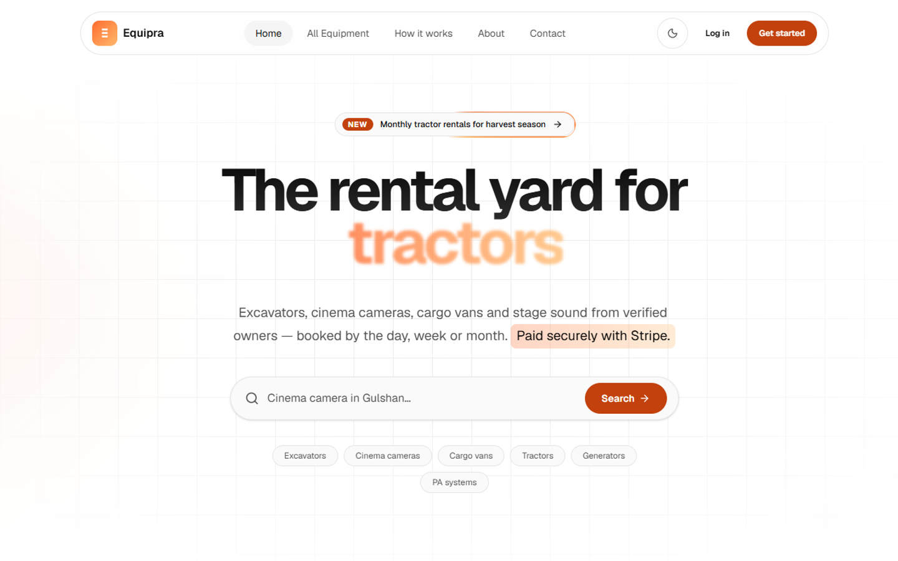
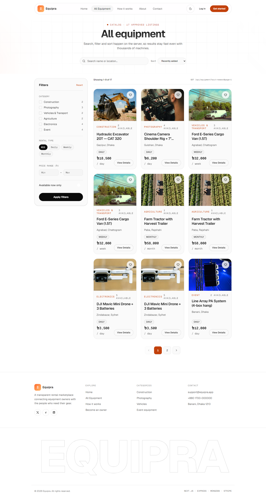
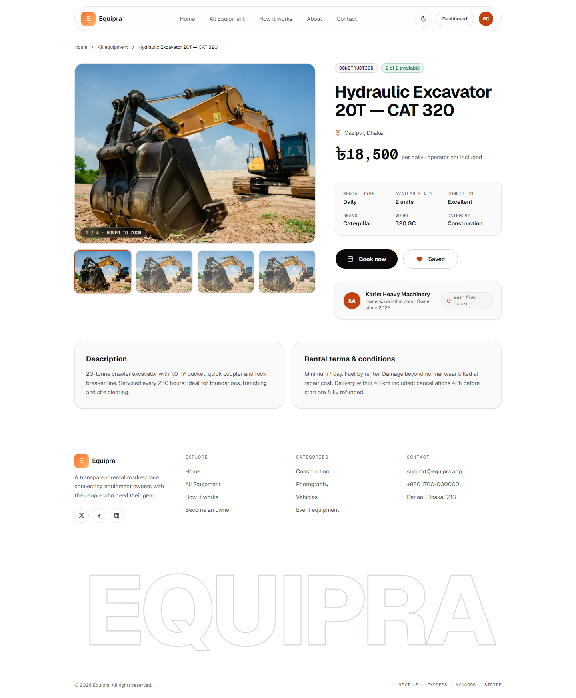
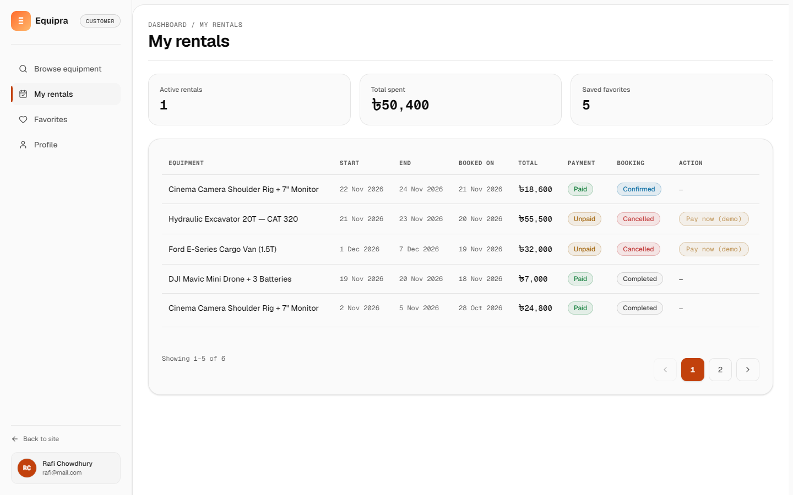
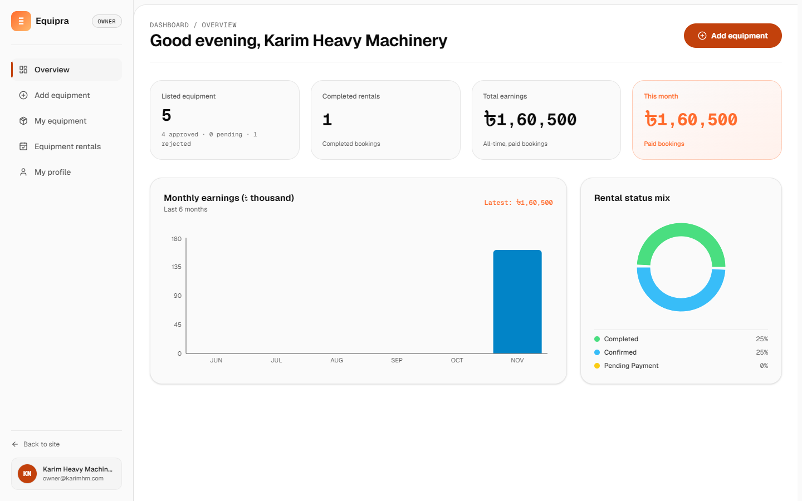
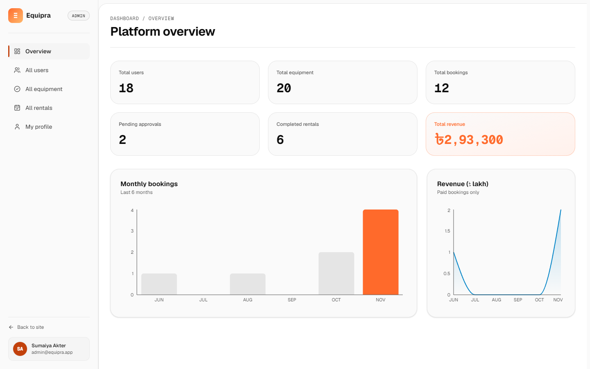

Dark:


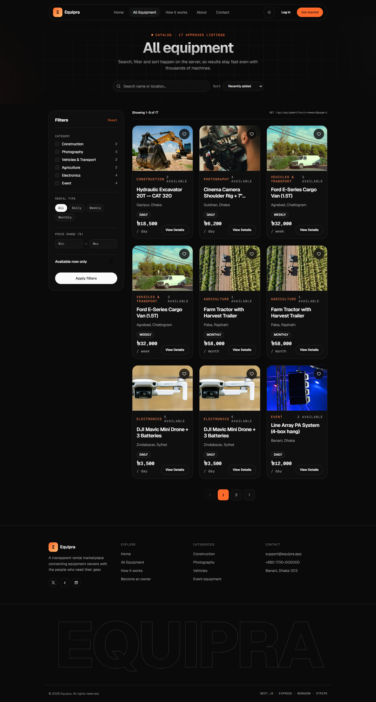
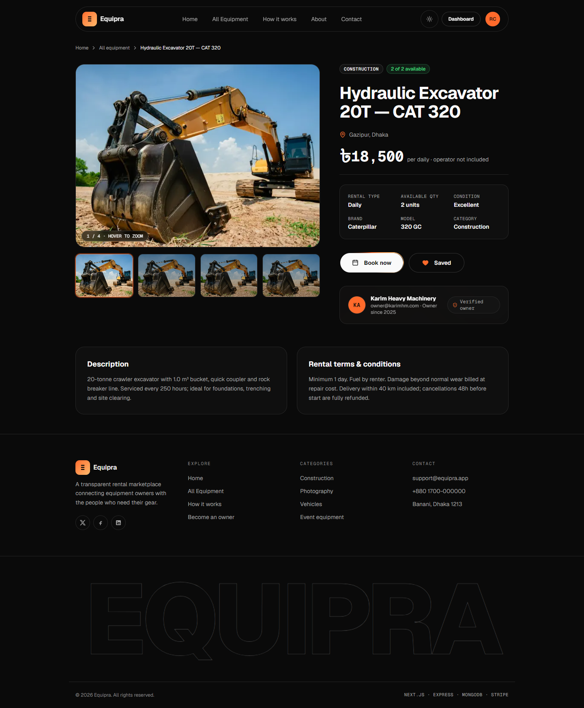
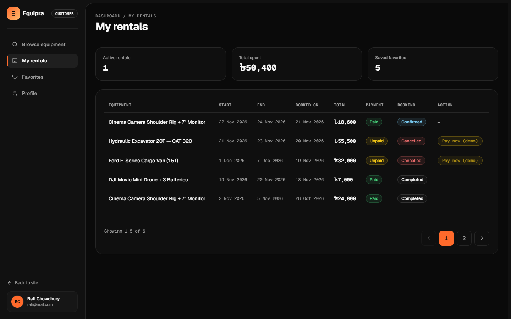
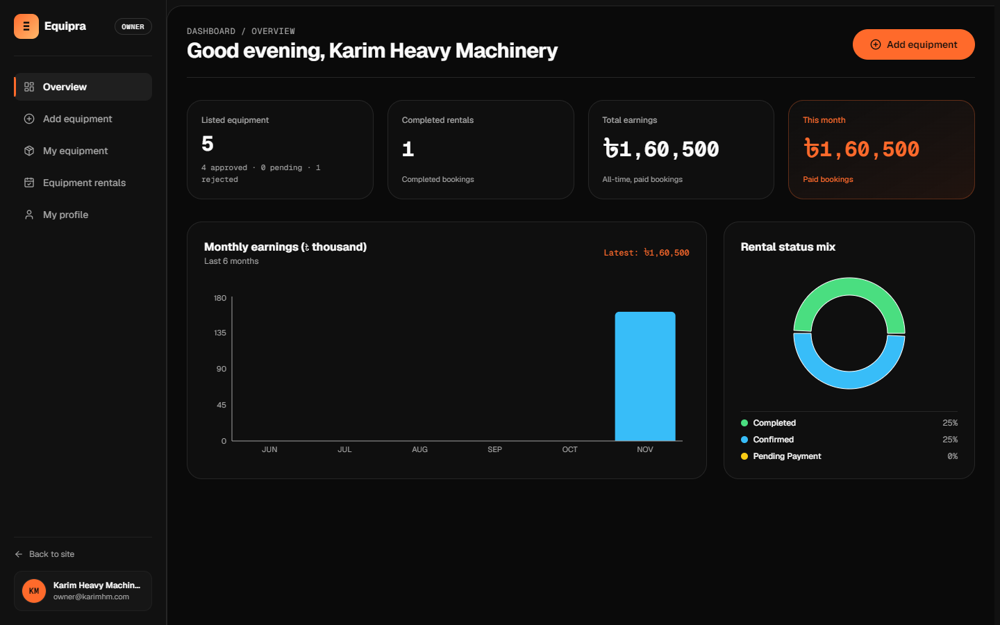
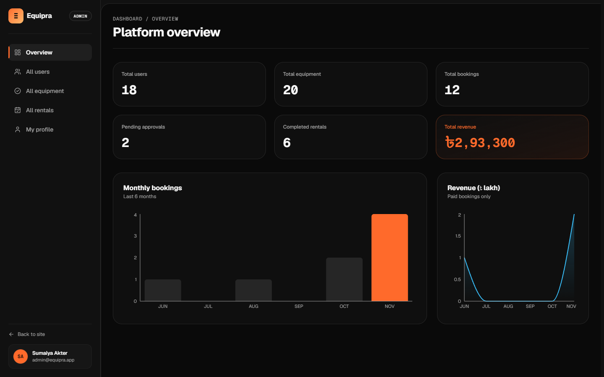

## Packages

- `next` — App Router (route groups, server components, `src/proxy.js` guards).
- `react` / `react-dom` — UI runtime.
- `tailwindcss` + `tw-animate-css` + `@tailwindcss/turbopack` — design tokens, utilities, animations.
- `next-themes` — light (default) / dark theme, saved in localStorage.
- `radix-ui` + `class-variance-authority` + `clsx` + `tailwind-merge` — shadcn primitives (buttons, dialogs, forms, tables).
- `better-auth` (+ `mongodb` adapter) — email/password + Google signup, sessions, roles.
- `axios` — API client with JWT interceptor.
- `@tanstack/react-query` — server state behind data hooks.
- `react-hook-form` + `@hookform/resolvers` + `zod` — forms + validation (incl. BD phone, password rule).
- `motion` — entrance/hover animation (reduced-motion aware).
- `recharts` — owner/admin analytics charts.
- `cmdk` — ⌘K command menu.
- `sonner` — toasts.
- `lucide-react` — icons.
- `@number-flow/react` — animated stat numbers.
- `jsonwebtoken` — dev-only token helper (tests); the real JWT comes from the server bridge.

## Env vars (names only — values never committed; see `.env.example`)

`NEXT_PUBLIC_API_URL`, `NEXT_PUBLIC_DATA_SOURCE`, `BETTER_AUTH_URL`, `BETTER_AUTH_SECRET`, `MONGODB_URI`, `DB_NAME`, `GOOGLE_CLIENT_ID`, `GOOGLE_CLIENT_SECRET`, `JWT_SECRET`, `JWT_ISSUER`, `JWT_AUDIENCE`, `NEXT_PUBLIC_IMGBB_KEY`, `SEED_ADMIN_PASSWORD`, `SEED_USER_PASSWORD`.

Copy `.env.example` to `.env.local` and fill in the values.

## Run locally + seed

```bash
npm install
cp .env.example .env.local     # then fill in the values

# terminal 1 — API
cd ../equipra-server && npm run dev     # http://localhost:5000

# terminal 2 — client
npm run dev                             # http://localhost:3000
```

```bash
npm run lint
npm run build
npm test        # node --test
npm run seed -- --db equipra_dev   # local development database
npm run seed -- --db equipra       # production database
```

Point the client at the API with `NEXT_PUBLIC_DATA_SOURCE=api` and `NEXT_PUBLIC_API_URL=http://localhost:5000/api`; leave the source as `mock` to work entirely on in-memory demo data.

Only `equipra_dev` and `equipra` are accepted as seed DB names; anything else refuses before connecting. The seed is idempotent — re-running upserts rather than duplicating — and creates the demo users, the 13 demo equipment rows (row 11 unavailable, row 12 rejected, row 13 pending), sample bookings with payments, and favorites.

## Booking → payment → confirmation → completion

1. "Continue to Stripe payment" creates a reservation (`pending` + `unpaid`, 30-minute hold) and a Stripe Checkout Session.
2. The booking is confirmed only after successful payment: Stripe returns to the success page, which calls `/payments/confirm` (idempotent — safe on reload). The Stripe webhook (`/payments/webhook`, signature-verified) confirms it too.
3. In production both paths are active: the success page calls `/payments/confirm`, and the Stripe webhook (`checkout.session.completed`) confirms the booking even if the customer closes the tab. Without Stripe keys the API returns `503 {"message":"Payments are not configured"}` and the booking modal shows that message.
4. After the end date passes, paid + confirmed bookings flip to `completed`; expired unpaid holds become `cancelled` (hourly housekeeping + daily serverless cron).
